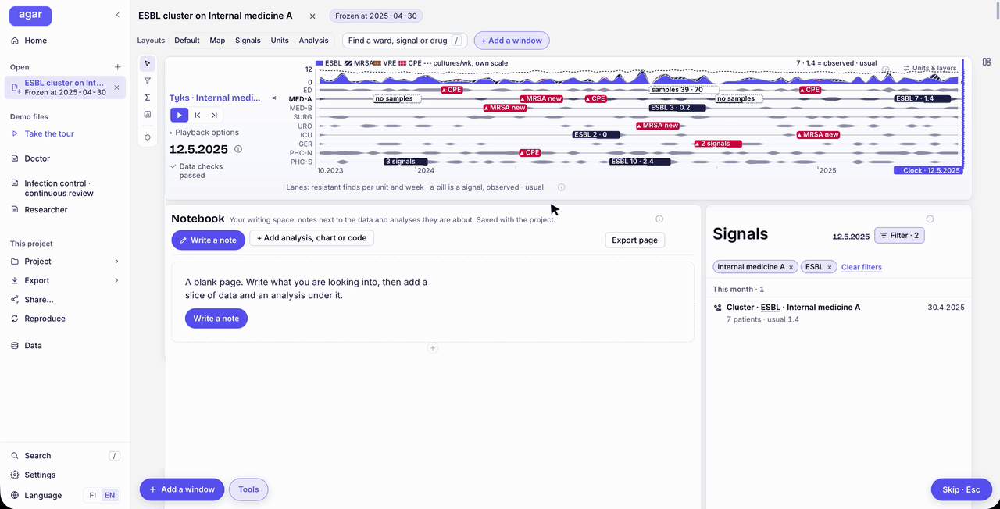
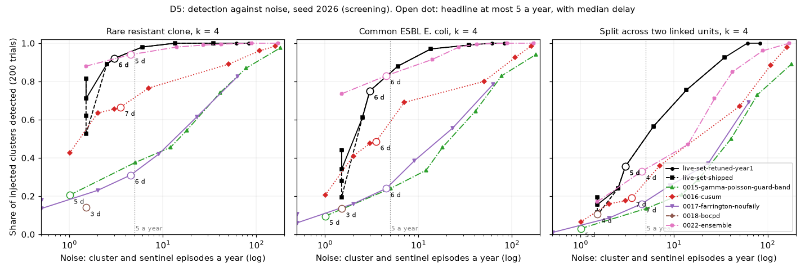

<div align="center">

# agar

**Antibiotic Efficacy Indicator & Reproducible AMR Research Workbench**  
*Built for the **Tyks Laboratories** Challenge · Turku Hackathon*

[](#the-challenge-speed-is-a-treatment)
[](#the-challenge-speed-is-a-treatment)
[](#running--live-hl7-demo)
[-0d9488?style=flat-square)](#what-we-built-alerts-we-measured)
[](#stack)

</div>

---

## Reproducible AMR Research Workbench in Action

<div align="center">
  
  <p><em><strong>agar Researcher Workbench (Frozen Project Snapshot):</strong> Starting from a clinical question, slicing an 8-week window on the multi-ward timeline (<code>Internal medicine A · 1 Mar – 30 Apr 2025</code>), computing the Bayesian Beta posterior share (<code>7 / 108</code> first isolates, <code>7.3%</code>, 95% credible interval <code>3.2%–12.8%</code>), inspecting the live-typeset mathematical formula and zero-dependency Python reproduction script, and pinning a publication-ready distribution chart.</em></p>
</div>

---

## The Challenge: Speed Is a Treatment

**agar** is our answer to the **Antibiotic Efficacy Indicator (AEI)** challenge by **Tyks Laboratories**: turning the culture results a laboratory already sends into a live, ward-level picture of antibiotic resistance—built both for **clinicians choosing empirical treatment at the bedside** and for **epidemiologists and AMR researchers watching for spread**.

Today, hospital resistance tables are compiled **once a year**, averaged across the entire institution, while an individual patient's culture takes 48 to 72 hours to grow. Because a severe infection worsens in hours and a resistant clone spreads across a ward in days, a year-old hospital-wide PDF is already obsolete when a clinician needs it:

- If a five-drug-resistant ESBL *E. coli* strain appears in four patients on the Urology ward inside three weeks, a hospital-wide annual average hides the local spike.
- Meanwhile, a 4-week ward slice often has fewer than 30 first isolates—showing a naive percentage misleads the clinician, while hiding the ward entirely loses local context.

The problem, the dataset, and the open clinical questions are documented in [`docs/CONTEXT.md`](docs/CONTEXT.md); who we build for and what each role needs is in [`docs/AUDIENCE.md`](docs/AUDIENCE.md); and our full research-workbench architecture is in [`docs/VISION.md`](docs/VISION.md) and [`docs/RESEARCH-TOOL-DESIGN.md`](docs/RESEARCH-TOOL-DESIGN.md).

---

## Two Workflows, One Mathematical Engine

Rather than a static BI dashboard over lab rows, **agar** pairs a 60-second bedside clinical view with a full notebook-driven epidemiological workbench—both powered by the same verified statistical gears in [`libs/utils`](libs/utils/README.md).

### 1. For the Bedside Clinician (`Treat a patient`)

- **Ward-Specific Empirical Coverage:** Ranks antibiotics for the clinician's exact unit (`ED`, `MED-A`, `MED-B`, `SURG`, `URO`, `ICU`, `GER`, `PHC-N`, `PHC-S`), specimen site (`urine`, `blood`, `wound`), and clinical syndrome—computed strictly on deduplicated first-isolate patient episodes (CLSI M39, 365-day lookback).
- **Three-Zone Clinical Readiness:** Divides antibiotics against clinical severity thresholds (**80% for mild**, **90% for severe/sepsis**) with Wilson confidence intervals:
  - **Start with (Green ✓):** Clears the efficacy threshold, ranking narrow-spectrum / WHO Access choices first.
  - **Also good enough (✓):** Proven alternatives when the first-line agent is contraindicated.
  - **Not a first choice (✕):** Falls below the safety threshold on this ward.
- **28-Day Ward Pulse Beside the 365-Day Baseline:** Every antibiotic row displays the unit's raw **last 28 days (`k / n` and `%` from 30 isolates)** right next to the 365-day share, surfacing sudden local shifts without sacrificing statistical stability.
- **Honest Small Numbers & Hierarchical Fallback:** When a ward pool has fewer than 30 first isolates, the tool explicitly states the sample size and shows what it falls back to (`Ward` $\to$ `Ward Type` $\to$ `Hospital`) instead of printing a noisy percentage.
- **Compound Instant Search (`/`):** Natural clinical shorthand—`"urology e. coli"`, `"icu blood severe"`, or `"med-a esbl"`—opens the pre-filtered coverage list or ward signals in one keystroke.

### 2. For the Epidemiologist & AMR Researcher (`Research Workbench`)

- **Continuous & Frozen Projects:** Everything a researcher does lives in a project that pins a scope (hospital site, wards, organisms, phenotypes, layout). Keep a project **Continuous** so new HL7 batches update every view and cell, or **Freeze** a snapshot (`asOf` cutoff date) so numbers never shift under a manuscript in progress.
- **Interactive Notebook Sandbox:** Arrange markdown notes, cohort **Slices** (synced with the timeline band or selected signal), **Timeline** strips, statistical **Tools** (*Rate*, *Compare*, *Share over time*, *Beta Posterior Estimate*, *Find Clusters*), **Code** cells, and **Charts** in a single reproducible document.
- **Transparent Math & Code Under Every Number:** Every analysis cell expands to show the exact typeset formula (`MathML` + **Copy LaTeX**) and a zero-dependency **Python** / **R** reproduction script generated directly from the active slice parameters.
- **Cross-Ward Patient Transfer Graph:** Models shared patients across all 9 units (6,477 of 8,829 sampled patients appear in more than one unit) to trace upstream and downstream transmission corridors around an affected ward.
- **Regional & National Surveillance Radar:** Connects hospital ward alerts to real **THL national infectious disease register** county series across Finland (with Benjamini-Hochberg false-discovery control across 8,250 county-months) and one-month-ahead negative-binomial county forecasts.
- **15-Check Lab Data-Hygiene Monitor:** Continuously audits incoming batches for 3-day ward sampling dropouts (caught in **93%** of trials), duplicate isolates, and EUCAST intrinsic-resistance anomalies before data errors can masquerade as resistance shifts.
- **1-Click Reproducible Science Bundle:** Export any finding as a self-contained bundle holding the filtered `CSV`, base-R script (`analysis.R`), Python script (`analysis.py`), Jupyter notebook (`.ipynb`), LaTeX methods (`method.tex`), and `results.json`.

---

## What We Built: Alerts We Measured

We didn't stop at building alerts—we measured them. Across [`benchmarks/overnight-2026-10-17`](benchmarks/overnight-2026-10-17/README.md), we planted **200 synthetic outbreaks per scenario** into the 3-year microbiology dataset (10,000 patients · 46,792 cultures · 24,571 isolates · 172,381 susceptibility results) and evaluated our shipped detectors against **8 alternative methods** from the statistical surveillance literature.

<div align="center">
  
</div>

### Key Benchmark Findings

- **Rare Resistant Clone Injections ($k = 4$ patients in 14 days):** For four-patient injections of a rare, identical 13-drug resistance profile into this synthetic dataset, our shipped detector finds the cluster **89% of the time** (95% CI: `84%–93%`, held-out seeds: `89%`), with a **median delay of 6 days**, at **4.5 signal episodes/year** (~`1.0` cluster episode/year). At the 3-episodes/year operating point on the D5 curve, sensitivity reaches **92%** (`94%` on held-out seeds).
- **Tested Against 8 Literature Baselines:** We benchmarked five alternative detectors—**Poisson & Bernoulli CUSUM** ([`0016`](experiments/0016-cusum/README.md)), **Improved Farrington / Noufaily** ([`0017`](experiments/0017-farrington-noufaily/README.md)), **Bayesian Online Change-Point Detection** ([`0018`](experiments/0018-bocpd/README.md)), **Gamma-Poisson with Benjamini-Hochberg FDR** ([`0015`](experiments/0015-gamma-poisson-guard-band/README.md)), and a **Rank-Product Ensemble** ([`0022`](experiments/0022-ensemble/README.md))—plus three coverage estimators (**Discounted Beta-Binomial** [`0012`](experiments/0012-discounted-beta-binomial/README.md), **Dirichlet Organism-Mix WISCA** [`0013`](experiments/0013-dirichlet-organism-mix/README.md), and **Hierarchical Pooling** [`0014`](experiments/0014-pooling-levels/README.md)).
- **Scientific Scope & Honesty ([`docs/PROTOCOL.md`](docs/PROTOCOL.md)):** No tested replacement met the predefined replacement criteria at the shipped operating point on this benchmark; that is not proof the method outperforms those statistical families in general. These rates apply to outbreaks shaped like our injections (identical copies of one isolate, which favours profile matching).

| Planted Benchmark Event | Detected | Delay from Onset | Classification |
| :--- | :---: | :---: | :--- |
| **E1 · ESBL *E. coli* in Urology** (June 2025) | **Yes** | 5 days (0d from `0002` start) | `Cluster` (4 patients vs. 0.2 expected) |
| **E2 · MRSA in the ICU** (March 2026) | **Yes** | **0 days** | `Sentinel` on first isolate, then `Cluster` |
| **E3 · Health Centre South Dropout** (Week 50, 2025) | **Yes** | **0 days** | `Data problem` (suppresses false resistance alerts) |
| **E4 · Trimethoprim Trend in Urinary *E. coli*** | **Yes** | First signal `2026-05-10` | `Trend` (Cochran-Armitage over 28-day bins) |

---

## Architecture: Gears and Mechanisms

This repository lays the foundation so that whatever we build—the web workbench, the bedside doctor view, the live HL7 server, and the iPhone app—sits on one untangled structure. Each piece of logic is written once, in one place, behind a small interface, and nothing reaches into another piece's internals.

```mermaid
flowchart LR
  subgraph Feeds["Data & Live Feeds"]
    HL7["HL7 v2.5.1 ORU^R01\n& Synthetic CSV Replay"]
    THL["THL National Register\n& StatFin Geometry"]
  end

  subgraph Gears["libs/utils (The Gears)"]
    Ingest["ingest · contract · sites"]
    Count["counting · eucast · quality"]
    Stat["detect · coverage · compare"]
    Work["projects · export · ask · i18n"]
  end

  subgraph Mechanisms["apps/ (The Mechanisms)"]
    API["apps/api\nLive Server & SSE Stream"]
    Web["apps/web\nClinician & Research Workbench"]
    Nb["apps/notebook\nJupyterLite & Python aei"]
    Video["apps/video & apps/ios\nRemotion Pitch & iOS"]
  end

  Feeds --> Ingest --> Count --> Stat --> Work --> Mechanisms
```



`libs/utils` holds the **gears**: statistical detectors, coverage estimators, CLSI M39 first-isolate counting, EUCAST rules, data-quality checks, project state, reproducible bundle exporters, bilingual i18n, and API clients. `apps/` holds the **mechanisms**: each app wires gears together into something a user touches and adds as little logic of its own as it can. If a piece of code could be useful to a second app, a benchmark, or an experiment, it belongs in `libs/utils` from the start.

### Repository Layout

```text
libs/utils/     reusable building blocks, one module per job (the gears);
                py/ holds the Python `aei` analysis package
apps/           thin products that combine utils (the mechanisms)
  api/          development server implementing the API contract & live HL7 ingest
  web/          the clinician & researcher web application (React + Vite)
  notebook/     in-browser JupyterLite environment preloaded with the `aei` wheel
  video/        62-second 1080p pitch film built in Remotion from live server snapshots
  ios/          the iPhone app
deploy/         everything about deployment: infrastructure, containers,
                CI/CD, multi-hospital environment configuration
scripts/        every script: setup, THL/Finres download, HL7 sender, scipy cross-checks
benchmarks/     repeatable measurements of utils and apps (speed, sensitivity,
                calibration) rerun as the code changes
research/       background reading notes with sources (users, domain,
                open data); describes the field, decides nothing
experiments/    one directory per experiment, NNNN-slug/README.md,
                started from experiments/TEMPLATE.md (git history is the lab notebook)
data/           datasets, git-ignored (docs/PROTOCOL.md)
prompts/        briefs for unattended agent sessions, dated; their reports go to benchmarks/
docs/           the project notes:
  CONTEXT.md              the challenge: problem, data, open questions
  AUDIENCE.md             the audiences, what each needs from the data, and team roles
  VISION.md               where we are going: a full research tool (projects, notes, tools, export)
  RESEARCH-TOOL-DESIGN.md the first slice of the vision: projects gear, routes, export gear, tools
  OBJECTIVES.md           what we prove with the data, how it is measured, system design
  ENGINE.md               the mathematical engine: every formula and output
  QUESTIONS.md            open machinery decisions with proposals, to be answered
  PROTOCOL.md             how an experiment is planned, run and recorded in git, and rules for claims
  DECISIONS.md            every technical, mathematical or statistical choice (D-001+), with rationale
  DEMO.md, JUDGE-FEEDBACK.md, MATH-REVIEW.md, RESEARCH-PLAN.md,
  RESEARCHER-WORKFLOWS.md, REVIEW.md
PRODUCT.md      product context for design work (read by the design tooling)
AGENTS.md       rules for AI agents working here
pyproject.toml  the Python analysis environment, managed by uv (D-024)
```

### Dependency Direction

Dependencies point strictly one way:

```text
apps, benchmarks, experiments, scripts  ──▶  libs/utils
```

- `libs/utils` imports nothing from `apps/`, `benchmarks/`, `experiments/`, `scripts/`, or `deploy/`.
- A `utils` module depends on another `utils` module only when it genuinely builds on it, and never in a cycle.
- Apps do not import each other. Logic two apps share moves to `libs/utils`.
- Nothing imports from `experiments/`. Code an experiment proves useful moves to `libs/utils` before anything else uses it.
- Configuration (keys, endpoints, model names) is passed in from outside, not hard-coded inside `utils`, so the same gear runs in every app and every environment.

---

## Stack

- **Web & API:** TypeScript in a `pnpm` monorepo workspace (`React 19` + `Vite` on the web, Node HTTP + Server-Sent Events on the API); Rust is planned for selected compute gears later.
- **Data Science & Verification:** Python managed with `uv` ([`D-024`](docs/DECISIONS.md)) for experiments, overnight benchmarks, and cross-checking TypeScript statistical distributions against `scipy`; everything the web app runs in production is native TypeScript.
- **Standards & Open Data:** HL7 v2.5.1 `ORU^R01` laboratory ingestion with national THL microbe/antibiotic codes, CLSI M39 first-isolate episode rules, EUCAST expert rules, and live THL Tartuntatautirekisteri / Statistics Finland county geometries (CC BY 4.0).

---

## Running & Live HL7 Demo

Requires **Node 22+** and **pnpm**. Unzip the organiser's dataset into `data/synthetic_microbiology_dataset/`, then:

```bash
pnpm install
pnpm dev          # Starts the API on :8787 and the web workbench on :5173
pnpm demo         # Live demo: loads data up to 1 June 2025, then streams HL7 v2.5.1 lab batches (docs/DEMO.md)
```

### Multi-Hospital Site Mode, Tests & Statistical Cross-Checks

```bash
# Run a second hospital on the same server (deploy/integration.md)
AEI_SITES=deploy/container/config/sites.example.json pnpm dev:api

# Unit tests, typechecking, and formatting
pnpm test         # Unit tests across gears and UI (Vitest)
pnpm typecheck    # Workspace-wide TypeScript check
pnpm check        # Lint and format check (Biome)
```

For Python analysis and verifying that the TypeScript statistical gears match `scipy` to machine precision (requires `uv`):

```bash
uv sync
uv run python scripts/crosscheck-stats/check.py   # Cross-checks TypeScript statistics against scipy
uv run python scripts/verify_experiments.py        # Re-runs and verifies experiment records
```

Design work goes through the Impeccable skill (`/impeccable`), installed in the repo for Claude Code and Codex; [`PRODUCT.md`](PRODUCT.md) holds the product context it reads.
